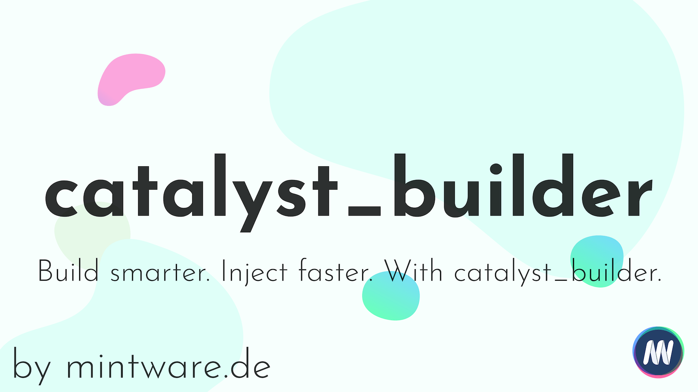
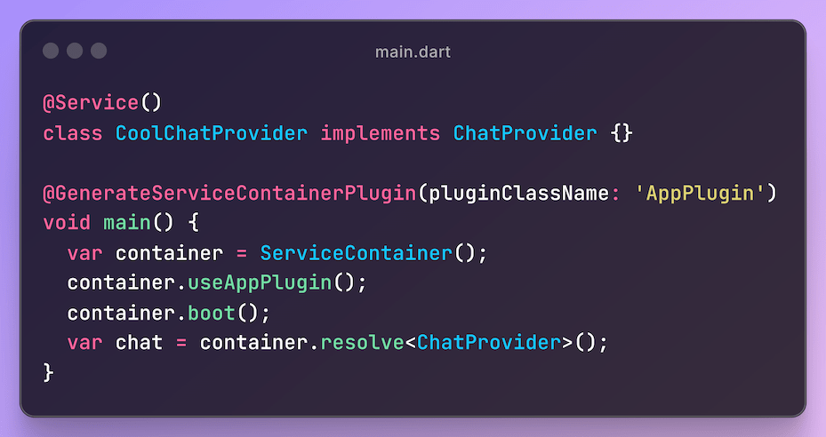

[](https://github.com/mintware-de/catalyst_builder/blob/main/packages/catalyst_builder/LICENSE)


[](https://pub.dartlang.org/packages/catalyst_builder)


# Catalyst Builder

A dependency injection container builder for dart.

Click on the image for a video on YouTube:

[](https://youtu.be/aJO7_bCOHRs?si=t9lhwQ5v31z-p4iw)

## Screenshot



## Background

Since [Catalyst](https://github.com/mintware-de/catalyst) is only for Dart
and [Flutter Catalyst](https://github.com/mintware-de/flutter_catalyst)
supports Flutter, but a mess to configure I decided to do something cooler.

Catalyst Builder is a dependency injection container builder for both, Dart and Flutter. It's easy to use and dependency
injection is almost done automatically. You only have to decorate your services with `@Service` and the build_runner
will create a service container for you.

## Installation & Documentation

You can find a quick start guide and further documentation for this package in the [wiki on GitHub](https://github.com/mintware-de/catalyst_builder/wiki).

Upgrading from 6.x to 7.x? Read the [upgrade guide](UPGRADE.md).

## Build time validation

The generator validates the service graph while it generates the plugin:

- **Errors** (abort the build): circular dependencies (`A -> B -> A`) and captive
  dependencies (a `singleton` that depends on a `scoped` service).
- **Warnings** (logged): required constructor parameters whose type is not a known service
  in this plugin (it may come from `parameters`, `register()` or another plugin) and two
  services that are exposed as the same type.

Configure the behavior with the `validation` option of the builder in your `build.yaml`:

```yaml
targets:
  $default:
    builders:
      catalyst_builder:buildServiceContainerPlugin:
        options:
          validation: strict   # strict | warn | off   (default: warn)
```

- `strict`: errors **and** warnings abort the build.
- `warn` (default): errors abort the build, warnings are logged.
- `off`: the service graph is not validated.
